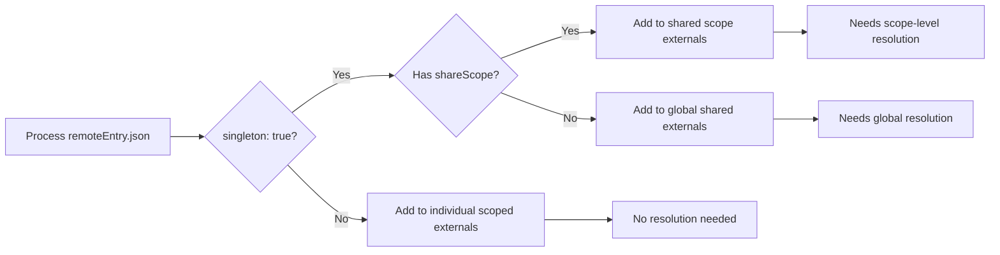
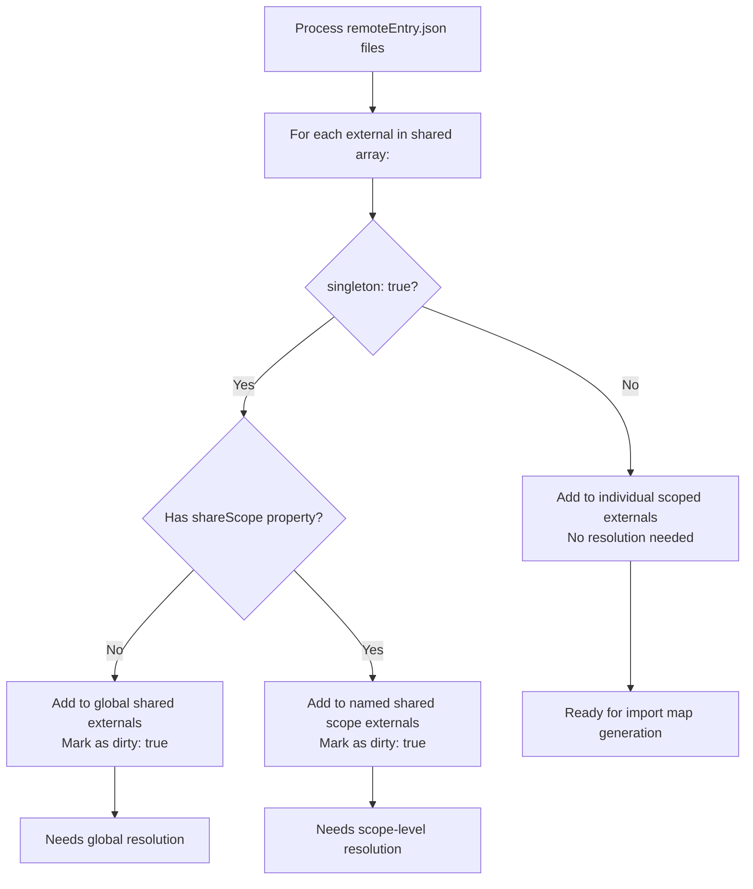
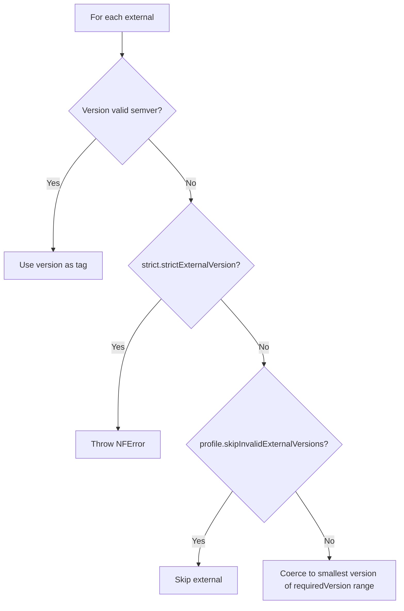
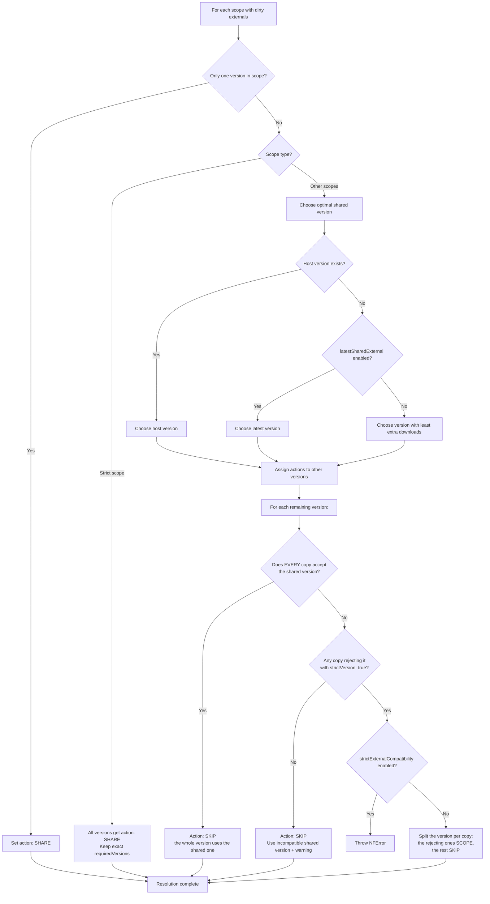
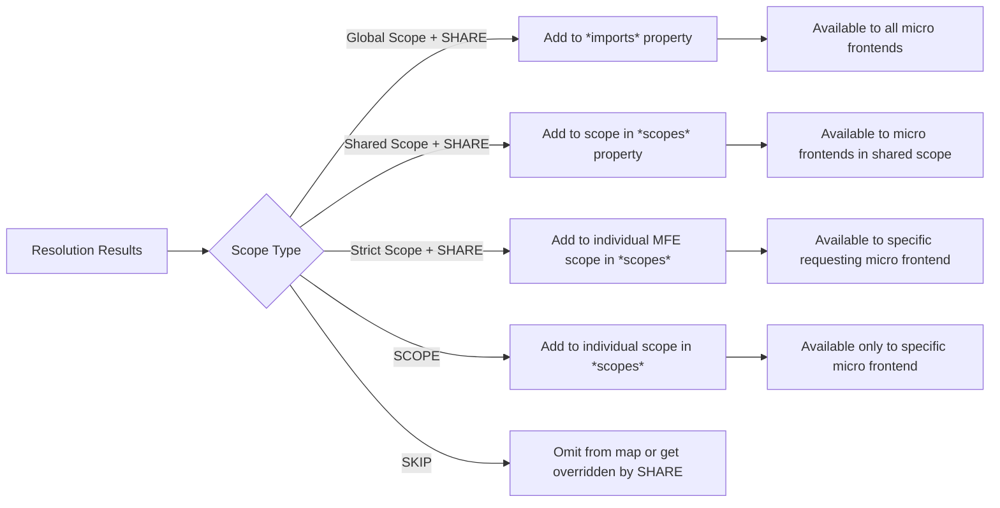
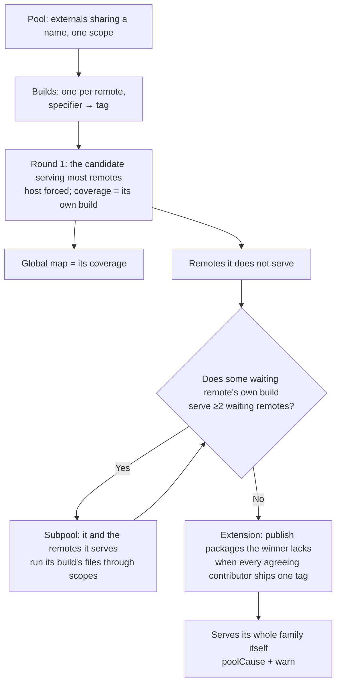
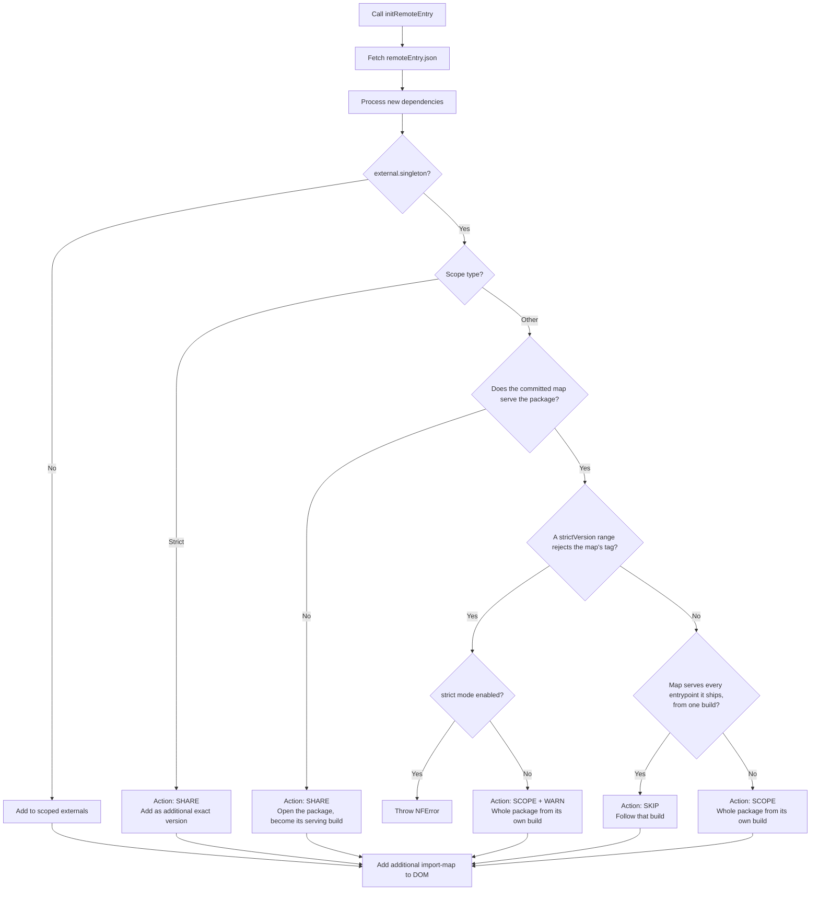
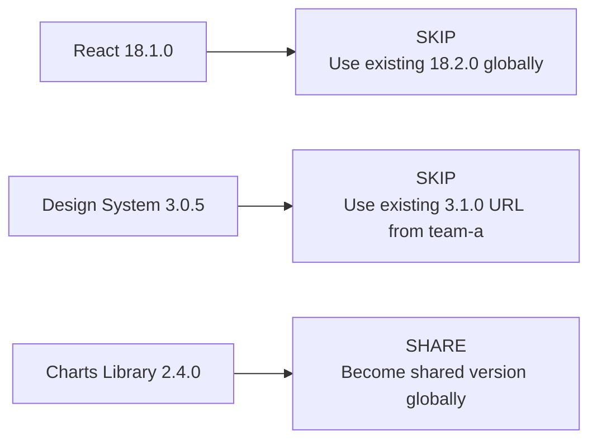
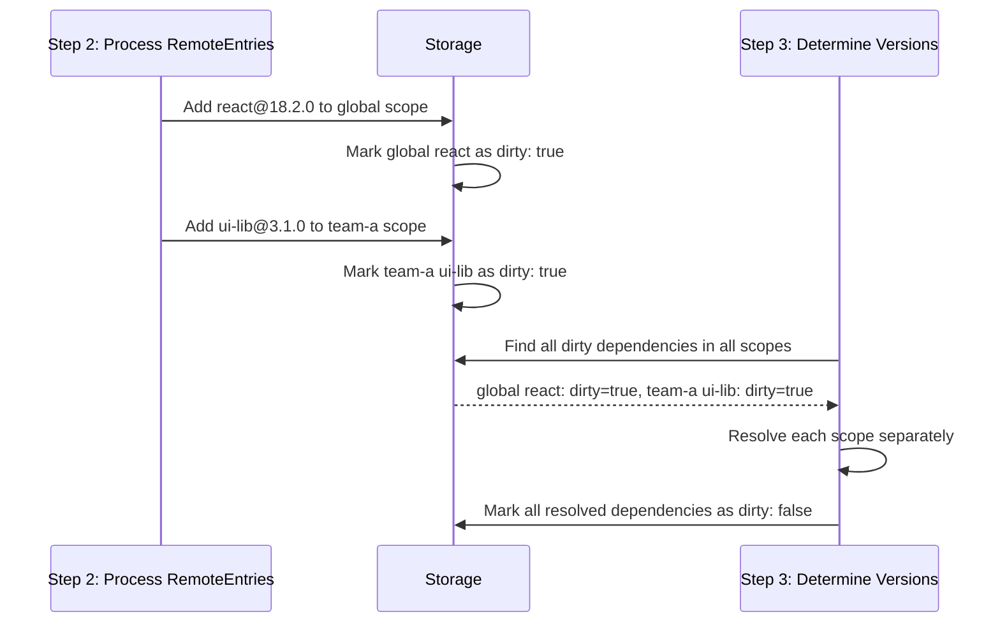
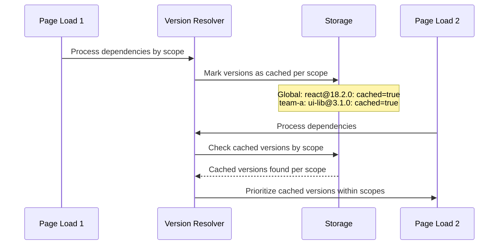

[< back](./../README.md)

# Version Resolver

The version resolver determines how to share externals (dependencies) across multiple remotes (micro frontends). It decides which external versions to share globally, share within specific scopes, or scope to individual remotes (micro frontends).

## How are the remotes bundled:

Native-federation provides a `federation.config.js` in its remotes. This configuration file allows the user to finetune which externals should be shared with other remotes and which should only be used by that specific remote. This process of choosing a specific (sub)set of remotes that can use a particular shared externals is called "scoping".

Whenever a remote is bundled, Native-federation includes a metadata file called the `remoteEntry.json`. When transpiled and bundled, a remote file structure looks like this:

```
📁 dist/
└── 📁 mfe1/
    ├── 📄 remoteEntry.json
    ├── 📄 button.js
    ├── 📄 dependency-a.js
    ├── 📄 dependency-b.js
    └── 📄 chunk-ABCD1234.js
```

The `remoteEntry.json` contains a translation of the `federation.config.js` and serves as metadata file to explain to the orchestrator which remotes can be shared and which have to be scoped:

```json
{
  "name": "team/mfe1",
  "exposes": [
    {
      "key": "./Button",
      "outFileName": "button.js"
    }
  ],
  "shared": [
    {
      "packageName": "dep-a",
      "outFileName": "dependency-a.js",
      "requiredVersion": "~2.1.0",
      "singleton": false,
      "strictVersion": true,
      "version": "2.1.1"
    },
    {
      "packageName": "dep-b",
      "outFileName": "dependency-b.js",
      "requiredVersion": "~2.1.0",
      "singleton": true,
      "strictVersion": true,
      "version": "2.1.2",
      "bundle": "browser-dep-b"
    }
  ],
  "chunks": {
    "browser-dep-b": ["chunk-ABCD1234.js"],
    "mapping-or-exposed": []
  }
}
```

These properties are very important for the orchestrator, here is what they mean:

- **requiredVersion:** The acceptable range of versions that this remote is compatible with.
- **singleton:** Should the orchestrator share this external with other remotes or use it only for this remote?
- **strictVersion:** Does the remote accept versions of this external that are outside of the accepted range (requiredVersion).
- **version:** The version of the external.
- **bundle:** (Optional) name of the internal chunk bundle this external belongs to, resolved via the `chunks` map on the same remoteEntry. See [Shared Chunks](./architecture.md#shared-chunks) for details.

## Understanding Import Maps

The orchestrator creates an import map from the provided remote metadata files (`remoteEntry.json`). Externals can be shared globally, shared within specific groups (shared scopes), or scoped to individual micro frontends.

### What is an Import Map?

An [import map](https://developer.mozilla.org/en-US/docs/Web/HTML/Reference/Elements/script/type/importmap) is a JSON structure that tells the browser where to find JavaScript ES module imports:

```javascript
{
  "imports": {
    "react": "https://cdn.example.com/react@18.2.0.js",
    "lodash": "https://cdn.example.com/lodash@4.17.21.js"
  },
  "scopes": {
    "https://legacy-mfe.example.com/": {
      "react": "https://legacy-mfe.example.com/react@17.0.2.js"
    }
  }
}
```

When your code does `import React from 'react'`, the browser uses this map to fetch the actual file.

### Only one shared version per scope

A major drawback of import-maps is that they can only specify **one version** of each dependency per scope:

```javascript
// ❌ This is NOT possible in import maps
{
  "imports": {
    "react": "https://cdn.example.com/react@18.2.0.js",
    "react": "https://cdn.example.com/react@17.0.2.js"  // Duplicate key!
  }
}
```

This limitation necessitates version resolution. When multiple micro frontends require different versions of the same dependency within a scope, only one can be shared "globally".

### The Solution: Multiple Scope Levels

Import maps provide **scopes** as solutions for dependency management:

```javascript
{
  "imports": {
    // Global scope - most micro frontends use this
    "react": "https://cdn.example.com/react@18.2.0.js",
    "ui-library": "https://cdn.example.com/ui-lib@2.1.0.js"
  },
  "scopes": {
    // Individual micro frontend scope
    "https://legacy-mfe.example.com/": {
      "react": "https://legacy-mfe.example.com/react@17.0.2.js"
    },

    // Linking multiple scopes to the same external can create a more fine-grained sharing of externals between a specific selection of remotes.
    "mfe1.example.com/": {
      "ui-library": "mfe1.example.com/ui-lib@3.0.0.js"
    },
    "mfe2.example.com/": {
      "ui-library": "mfe1.example.com/ui-lib@3.0.0.js"
    }
  }
}
```

**How it works**:

- **Global sharing**: Most micro frontends use React 18.2.0 and UI Library 2.1.0
- **Individual scoping**: Legacy MFE gets its own React 17.0.2
- **shareScope grouping**: Design system MFEs share UI Library 3.0.0.

**Specificity**:

The order of precedence is based on the specificity of the scope, with the global import having the lowest precedence.

> **Note:** With the "shareScope" grouping (3rd example), the import map is being tricked in loading the same file for 2 different scopes. This is handled by the orchestrator internally and provides a way to share an external over a select set of scopes. More on this later.

## Shared vs Scoped Dependencies

In the remote's metadata file (remoteEntry.json), dependencies are marked as "externals". Every external contains configuration that determines how it should be shared.

### Shared externals (singleton: true)

Dependencies marked as `singleton: true` are candidates for sharing:

```json
// In remoteEntry.json
{
  "shared": [
    {
      "packageName": "react",
      "singleton": true,
      "version": "18.2.0",
      "requiredVersion": "^18.0.0"
    }
  ]
}
```

**Result**: This dependency is a candidate to be placed in the imports object (in the importmap).

### Scoped externals (singleton: false)

Dependencies with `singleton: false` are always scoped to their individual remote:

```json
// In remoteEntry.json
{
  "shared": [
    {
      "packageName": "lodash-utils",
      "singleton": false,
      "version": "1.0.0"
    }
  ]
}
```

**Result**: This external is placed in the scope of its remote. And therefore only available to that specific remote.

### Secondary entrypoints (the `entries` map)

A package can expose more than one import specifier — a primary entrypoint (`@angular/core`) and one or
more secondary entrypoints (`@angular/core/testing`, `@angular/core/rxjs-interop`, …). Core v4.3.0 groups
these under a single `DenseSharedInfo`, replacing the flat `outFileName` with an `entries` map from each
specifier to its output file:

```json
// In remoteEntry.json
{
  "shared": [
    {
      "packageName": "@angular/core",
      "singleton": true,
      "version": "20.0.0",
      "requiredVersion": "^20.0.0",
      "entries": {
        "@angular/core": "core.js",
        "@angular/core/testing": "core-testing.js"
      }
    }
  ]
}
```

The resolver treats the whole `entries` map as one shared external: version negotiation happens once per
package, and every specifier in `entries` follows the winning version's placement — scoped, shareScope,
global, or the skip/override redirect. When a shared version wins, its serving build's `entries` publish, so
every secondary entrypoint that build ships resolves to the same build as its primary (see
[Copies of one version](#copies-of-one-version) for the version's other copies). (Older/flat remote
builds emit one `SharedInfo` per specifier; set [`feature.convertFlatSharedInfo`](./config.md#modeConfig) to
group them at runtime.)

#### The basis of a version

Several remotes can report the same version of a package, and they all land in one `SharedVersion` as its
`remotes` list. They build the same tag, but each bundles only the entrypoints it actually imports, so the
lists can differ. `remotes[0]` is the version's **basis** — the copy that serves every specifier it
declares — and the cache keeps it sorted on insert by this precedence:

1. **host** — the shell's build is already loaded in the browser and cannot be repointed.
2. **cached** — an already-served copy; repointing it would invalidate a committed import map and force a
   redundant download.
3. **widest coverage** — the copy declaring the most entrypoints, so fewest builds are needed.
4. **name** — an exact tie goes to the remote whose name sorts first (code-unit order), so the basis does not
   depend on the order remotes register in. A tie never repoints a host or cached basis: a dynamic load keeps
   the committed build, and the name decides only among copies none of which is the host or cached yet (a cold
   init, or a version new to storage).

Rule 3 is what makes a superset copy win: given `{table}`, `{table}` and `{sort, table}` of one version,
the third becomes the basis and serves both specifiers from a single build. Rules 1 and 2 deliberately
outrank it — stability beats optimality — so a host or already-served basis can lack an entrypoint a sibling
ships (see [One build per package](#one-build-per-package) for the build that then serves the package).

#### One build per package

A package is its primary external plus any flat secondary externals (`@angular/core/testing` reported as an
external of its own). Per share scope — global and each named shareScope — every package is served from
**one build**, picked after the shared versions are determined and stored as `servingBuild` on every
external of the package in that scope. A dynamic load that opens a package the committed map does not serve
stores the loaded remote as its serving build, as an election would (see
[Scope and dynamic init](#scope-and-dynamic-init)).

- A **pooled** package takes its pool's winner, the build its election made global, when the winner has a copy
  in the primary's share row (or in any share row of the package when the primary has none). It is not ranked
  again: without such a copy it takes the widest copy in those rows that publishes its own files (the most
  entrypoints across the package's externals, then the name that sorts first), and it has no serving build only
  when no such copy is left.
- An **unpooled** package ranks the copies that publish their own files in its primary's share rows, or in
  every share row of its externals when the primary has none (a package can ship secondary entrypoints only),
  leaving out a remote that ships the package at two tags unless it is the host:
  1. **host** — the shell's build.
  2. **fewest extra downloads** — one for the build itself unless its copies of the package are all cached,
     plus one for every other remote that would run its own build of the package (a copy in a `scope` row, a
     `strictVersion` copy whose range rejects the tag, or a fallback, key 3) unless that remote's copies are all
     cached.
  3. **fewest fallbacks** — the remotes that ship a specifier of the package outside the candidate's copies at
     its tag, that would run one external of the package from a `scope` row and another from the map, or that
     ship the package at two tags; each runs the whole package from its own build (see
     [Entrypoint coverage and tearing](#entrypoint-coverage-and-tearing)).
  4. **primary's basis** — the basis of the primary's share row.
  5. **name** — code-unit order, so the choice never depends on the order remotes register in.

Every specifier the serving build ships is served from it, also when another external of the package lists it:
with a dense `@angular/core` and a flat `@angular/core/testing` at the same tag, `@angular/core/testing` comes
from the serving build, not from whichever external the record lists first. A share row of an external whose
name another external already serves at the same tag publishes nothing, and is not reported as a second
shared version; only a share row at another tag is.

The primary fixes the tag its secondaries follow. In an unpooled package every share row at another tag follows
the serving tag, once the remotes the serving build does not cover have moved to `scope` rows: its copies
`skip`, and a `strictVersion` copy whose range rejects the tag is scoped, or fails init under
[`strict.strictExternalCompatibility`](./config.md#modeConfig), as in
[Determine Shared Versions](#determine-shared-versions). A pooled package keeps the rows its election placed.

A remote can ship one package at two tags: sharedMappings that carry versions of their own (`@org/shared/ui` 1.0.0
beside `@org/shared/util` 2.0.0), or npm secondaries that a wildcard export stamps with the range's version beside
the installed root (`17.1.0` beside `17.1.1`). Its build cannot serve both tags as one, so in an unpooled package
such a remote is no candidate and never follows another build: it runs the whole package from its own build. When
that leaves no candidate, nothing serves the package globally and every remote with a copy of it on the map runs
its own build. The host is the exception whenever it is a candidate (it has a copy in the primary's share rows, or
the primary has none): it serves every tag it ships, globally, and is never scoped. Its share rows at other tags
stay shared, and a remote whose specifiers its copies cover follows it. A `strictVersion` copy whose range rejects
a host file it would take at a tag other than the serving tag runs the package from its own build instead, as a
runtime load of it does.

#### Copies of one version

Copies of one version build the same tag, so a specifier two of them ship is the same published code, and one
only some of them bundle is not a conflict between them. Pooling relies on this when it asks whether one build
shipped a combination: a build that ships a package at a tag also stands for that package's other entrypoints
at it (see [How pooling resolves](#how-pooling-resolves)).

It does not make their files interchangeable: a file binds its own imports where its build lives. A version
with a serving build publishes that build's entries alone (see [One build per package](#one-build-per-package)),
and a copy that declares an entrypoint the serving build lacks runs its package from its own build (see [Entrypoint
coverage and tearing](#entrypoint-coverage-and-tearing)). The version's other `share`-row copies publish nothing,
so a page that starts warm after a dynamic load still runs the package from the one build that serves it. An
external without a serving build publishes its `share`-row copies in record order, each specifier from the first
copy that declares it. A package in the `strict` scope has no serving build: its `share`-row copies publish in
basis precedence, tag by tag (see [Entrypoint coverage and tearing](#entrypoint-coverage-and-tearing)).

Only copies that publish their own files can serve a version. A copy pooling has placed in a foreign build's
subpool (`servedBy`, see [How pooling resolves](#how-pooling-resolves)) runs that build's files, named in its
own scope per consumer, so what it bundles answers for itself alone. Pooling keeps a subpool copy out of the
basis slot for this reason, so a shared version always has its basis to serve from.

#### Entrypoint coverage and tearing

The build serving a package does not always ship every specifier a consumer imports. A `skip` version
redirected to the winner can declare a secondary entrypoint the winner's copy lacks — for example the shared
version ships `@angular/core` while a compatible, deduped remote on another tag also imports
`@angular/core/testing`:

```
@angular/core  20.0.0  share  mfe-a  entries { @angular/core }
@angular/core  20.1.0  skip   mfe-b  entries { @angular/core, @angular/core/testing }
```

Serving those two specifiers from two **different builds** is a **tear**. It is harmless for most libraries but
breaks packages whose secondary entrypoints share module-singleton state with the primary. Outside the `strict`
share scope, a remote at init never resolves its own imports of one package to two builds, with one exception: a
host whose build ships a secondary entrypoint without its root (see
[When the host's build lacks an entrypoint](#when-the-hosts-build-lacks-an-entrypoint)).
mfe-b above runs both specifiers from its own build: its copies move to `scope` rows at 20.1.0, and mfe-a's build
keeps serving everyone else. The same holds within one version: a copy of the shared tag that ships an
entrypoint the serving copy lacks runs its package from its own build too. So does a remote whose flat
secondary external is scoped, say because its `strictVersion` range rejects that external's tag: it runs the
primary from its own build as well, even where the serving build ships both. A shared file of another package can
still bind the shared copy of a package the remote runs from its own build (see
[Declare the coupling you actually have](#declare-the-coupling-you-actually-have)).

The `strict` scope has no serving build: the copies of one tag merge their entries, each specifier served by the
first copy that declares it in basis precedence, so a copy can run its root from another copy's build beside a
secondary from its own.

**Inside a pool the unit is the family.** Pooling tests coverage **per specifier**, and a remote no build
covers takes its whole family from its own build (see [How pooling resolves](#how-pooling-resolves)): leaving
the map for one package only would tear one level up, since the shared files of its other packages bind the
shared copy of the one it left. Per specifier is the load-bearing part: a build can be the elected basis of
every *member* of a pool and still not carry one secondary entrypoint; a remote importing it is not served by
that build and runs its whole family from a subpool's build that serves it, or else from its own
(`uncovered`). Outside a pool no family is declared, so the unit is the package (see
[Declare the coupling you actually have](#declare-the-coupling-you-actually-have)).

A subpool copy resolves through its subpool's build rather than through the version, so it neither covers
another copy nor is torn by the version.

A dynamic load (`initRemoteEntry`) cannot change the committed map, so it takes each package of the loaded
remote as a whole: it follows the build the map serves every entrypoint it ships from, or runs the whole package
from its own build, never part of it on the map's files and part on its own (see
[Scope and dynamic init](#scope-and-dynamic-init)). It reads what the **committed** map publishes, not the union
of a version's copies: a specifier only a sibling copy ships is not on the map, so it covers nobody.

To minimise tears the resolver also uses coverage as a **tiebreaker** when choosing
the shared version: among candidates that tie on the extra-downloads heuristic, it prefers the one whose
copies together leave the fewest specifiers uncovered across the versions it would skip. It counts every copy of
the candidate's tag, as the serving build is decided later and may be any of them. A decisive
extra-downloads winner is never overridden, and an exact tie still keeps the highest version.

#### When the host's build lacks an entrypoint

The host's files can import a specifier its build never declared: an entrypoint the build skipped, or one a
shared package loads through a dynamic `import()` that the build's unused-dependency pruning does not see. Init
reads only what builds declare, never what their files import, so it cannot tell this from an entrypoint nobody
needs. The host is never repointed and never borrows the specifier from another build, even one at the same tag,
so the host's import of it does not resolve. It comes in two shapes:

- **The host lacks a secondary entrypoint a remote ships** (`@fw/core/rxjs-interop` beside the host's
  `@fw/core`). The global map leaves the specifier unmapped, and the remote that ships it runs the package —
  pooled, its whole family — from its own build.
- **The host ships a secondary entrypoint without its root** (`@fw/core/rxjs-interop`, no `@fw/core`). Pooled,
  the root stays unmapped and the host's import of it unresolved; the remotes run the root off the map. Unpooled,
  the serving remote publishes its root globally and the host's secondary moves to the host's own scope, where
  its import of the root binds the remote's: no build ships both, so the host runs the package from two builds.

Neither is repaired at runtime; the fix is in the host's build:

- Do not `skip` an entrypoint the host's shared packages import: skipping `@angular/common/http` leaves
  `@angular/platform-browser`'s static import of it unresolved, and the page fails to load.
- For a dynamic import the pruning misses, set `features.ignoreUnusedDeps: false`, or keep every secondary of
  the package with `includeSecondaries: { keepAll: true }` on its shared external. Angular's
  `provideAnimationsAsync()` is the known case: `@angular/platform-browser/animations/async` loads
  `@angular/animations/browser` dynamically, the default build omits it, and the host's animations silently
  never run.

### Shared scopes

By default, externals with the `singleton: true` property are shared globally between all remotes. The `shareScope` property can be used for externals that should only be shared over a select group of remotes. The `shareScope` property creates a logical group for dependency resolution. Externals with the same shared scope are resolved together in isolation from other share scopes.

This can be useful e.g. if some legacy remotes are still dependent on a previous major of a framework:

> Internally, shared "scope groups" don't exist in import maps, therefore it is only possible through overriding the specific scopes with 'the same url'.

```json
// Team A micro frontends - share UI components v3.x
{
  "shared": [{
    "packageName": "ui-components",
    "singleton": true,
    "shareScope": "team-a",
    "version": "3.1.0",
    "requiredVersion": "^3.0.0"
  }]
}

// Team B micro frontends - share UI components v2.x
{
  "shared": [{
    "packageName": "ui-components",
    "singleton": true,
    "shareScope": "team-b",
    "version": "2.5.0",
    "requiredVersion": "^2.0.0"
  }]
}

// Global shared dependency
{
  "shared": [{
    "packageName": "react",
    "singleton": true,
    "version": "18.2.0",
    "requiredVersion": "^18.0.0"
  }]
}
```

**How shared scopes work:**

1. **Resolution**: Dependencies with the same `shareScope` are grouped and resolved together
2. **Sharing**: The version within a logical group that is deemed to be most optimal for sharing is shared among all micro frontends in that logical group
3. **Import Map**: Each micro frontend within the logical group gets the shared version added to its individual scope in the final import map

### The "strict" shareScope

The special `shareScope: "strict"` shareScope enables exact version matching instead of semantic version range compatibility. This is useful when you need precise version control and want to share multiple specific versions of the same dependency.

```json
// Strict sharing - only exact versions are matched
{
  "shared": [
    {
      "packageName": "ui-library",
      "singleton": true,
      "shareScope": "strict",
      "version": "2.1.1",
      "requiredVersion": "^2.1.0" // Will be replaced with exact version 2.1.1
    }
  ]
}
```

**Differences compared to regular "share scopes":**

While a regular shareScope (including "global") shares only the most compatible version and scopes the rest of the provided incompatible versions. The "strict" shareScope will share _all_ provided versions. The shared versions will be stripped of their requiredVersion range and exposed as exact versions. This way, remotes can still share dependencies while receiving their own exact provided version. This is good for externals that have many breaking updates or incompatibilities between (patch) versions.

**Example: Multiple exact versions sharing**

```json
// Team A - Framework 15.2.1
{
  "shared": [{
    "packageName": "@framework/core",
    "singleton": true,
    "shareScope": "strict",
    "version": "15.2.1",
    "requiredVersion": "15.2.1"  // Exact version required
  }]
}

// Team B - Framework 15.2.3
{
  "shared": [{
    "packageName": "@framework/core",
    "singleton": true,
    "shareScope": "strict",
    "version": "15.2.3",
    "requiredVersion": "15.2.3"  // Different patch, potential incompatibility
  }]
}

// Result: Both teams get their exact framework version
// No runtime compatibility issues from mismatched compiled code
```

This prevents the runtime errors that occur when framework's interdependent modules (e.g. @angular/common -> @angular/core) expects specific internal APIs that may have changed between patch versions.

**When to use strict shareScope:**

- **Compiled Frameworks**: `@framework/*` related packages, where patch versions can break compatibility due to ahead-of-time (AOT) compilation
- **Breaking Changes**: When minor/patch versions introduce breaking changes despite semantic versioning
- **API Contracts**: When exact version matching is required for API compatibility

**Limitations:**

- No automatic version resolution - each remote gets exactly what it specifies
- Potential for more downloads compared to compatible version ranges
- Requires careful coordination between teams, especially when using monorepo-style dependencies subdivided into multiple packages. This feature does not fix an incompatibility between remotes.

## Resolution Process

The resolver creates an import map based on the provided metadata (remoteEntry.json) files, processing dependencies at multiple scope levels.

### Step 1: Categorize Dependencies by Scope



### Step 2: Resolve Dependencies by Scope

Dependencies are resolved separately for each scope:

```
// Input: Multiple scopes with different versions

Global scope:
  react@18.2.0 (requires "^18.0.0", singleton: true)
  react@18.1.0 (requires "^18.0.0", singleton: true)

"team-a" scope:
  ui-lib@3.1.0 (requires "^3.0.0", singleton: true, shareScope: "team-a")
  ui-lib@3.0.5 (requires "^3.0.0", singleton: true, shareScope: "team-a")

"team-b" scope:
  ui-lib@2.5.0 (requires "^2.0.0", singleton: true, shareScope: "team-b")

"strict" scope:
  design-tokens@2.1.0 (requires "2.1.0", singleton: true, shareScope: "strict")
  design-tokens@2.2.0 (requires "2.2.0", singleton: true, shareScope: "strict")

Individual scopes:
  lodash@4.17.21 (singleton: false)
```

### Step 3: Resolution Algorithm

For each scope (global, shared scopes, strict, individual), the resolver determines one or more versions to share. The first step is to check wether the external should be shared or not:



#### Version Validation

An external's `version` is optional and may be missing or non-semver. Before it is stored, an invalid version is handled in precedence order: throw, skip, or coerce (default). The result is always valid semver.



#### Determine Shared Versions

When the shared externals have been discovered, it is time for the resolver to determine which version to share of each shared external. This processs is partially based on the provided config of the user. There are multiple scopes, 1 global and 1 for each shareScope, the resolver loops through the scopes as follows:



> Externals in a [pool](#dependency-pooling) skip this flow: the pool elects its members together, and
> `determine` only reports them as re-elected.

> The "least extra downloads" choice (F5) is tie-broken by entrypoint coverage. See
> [Entrypoint coverage and tearing](#entrypoint-coverage-and-tearing).

#### A verdict belongs to the copy, not the version

Note where the two questions are asked, because they are asked at different granularities. **Whether a
version may be redirected** (G2) is asked of the version as a whole: it is one file served from one basis,
so redirecting it has to satisfy every remote it would redirect — see `versionDemands`. **Whose build must
change** (G8) is per copy: `requiredVersion` and `strictVersion` are per-build settings, so two remotes
that happen to ship the same tag can disagree about the winner, and only the ones that reject it keep their
own build.

So a version that fails G2 is **split**: the rejecting copies become a `scope` version at that tag, the
rest stay `skip` and dedup. A tag can therefore hold two versions in the record, one `skip` and one
`scope` — at most one of each, and both sorted where that tag belongs. Three consequences worth knowing:

- **A copy always accepts its own version.** A copy runs the build it ships whatever its range says, so a
  range that excludes its own version (one drifted from the lockfile, `~19.1.0` shipping 19.2.15) never
  rejects it — in determine, in pooling and on the dynamic path alike. Versions compare by semver, so
  `v19.2.15` is `19.2.15`. The drift is logged as a warning when the remote is stored.
- **Prereleases follow semver.** A range admits a prerelease only on its own `major.minor.patch`
  (`^20.0.0-rc.1` takes `20.0.0-rc.2`; `>=19.2.0` takes no `20.0.0-rc.x`), so a remote on a release range is
  incompatible with a prerelease build, and pooling islands it — unless that prerelease is its own version.
- **The winner is never split.** Its copies all accept its tag, as above, and host precedence makes the
  host's version the winner, so a host copy never lands in a `scope` version.
- **A copy declaring `strictVersion: false` dedups** even where its own range rejects the shared version —
  that is what the flag asks for — rather than being carried into a strict sibling's `scope`.
- **The objective prices the split**, not the version: see
  [Optimal Version Strategy](#3-optimal-version-strategy-default).


### Step 4: Generate Import Map

The resolver creates different import map sections based on scope and actions:



## Dependency Pooling

The resolver above resolves every shared external **independently**: each one picks its own shared
version, sourced from whichever remote contributed that winning tag. Packages that must move together
can therefore split — `@framework/core` and `@framework/common` resolved against different versions,
or served from different remotes, even when one coherent version exists.

The sharper hazard is **transitive coupling** through a shared intermediary. Suppose a design system
`@design-system/ui` is built against `@framework/core`, shared from mfe-A (framework 15), and mfe-B
(framework 16) consumes that shared design system. mfe-B now loads two framework runtimes — its own
`core@16` plus the `core@15` the design system drags in — and breaks (e.g. two DI containers that
cannot see each other). The coupled group must resolve to one mutually-compatible version _together_,
and that has to hold transitively through intermediaries like the design system.

**Pooling** groups such externals and elects them **as one family**: every remote takes the whole group
from one build that shipped it together — the elected one, another remote's, or its own. Pooled externals
are elected by pooling alone; the per-external resolver leaves them untouched (see
[Determine Shared Versions](#determine-shared-versions)).

### Pooling terms

| term | meaning |
| --- | --- |
| **label** | The `pool` field a remote sets on a shared external in its `remoteEntry.json`. Pooling's input, stored as declared and never rewritten (see [Enabling pooling](#enabling-pooling)). |
| **pool** | The externals of one share scope that labels connect, a secondary entrypoint joining its package. Named after the label most of its copies declare and stored as `poolName`. |
| **family** | A pool's members seen as one unit: the coupled packages (`@framework/*`) that must move together. A remote's family is the members it ships; it **serves its own family** when it runs its own build for all of them. "Pool" names the grouping, "family" what it holds. |
| **member** | An external in a pool. |
| **copy** | One remote's entry for one member at one version (a `SharedVersionMeta` in the record). |
| **row** | One of an external's `versions` in the record: a tag, an action (`share`, `skip` or `scope`) and the copies that take it. Pooling writes one row per `(tag, action)` (see [How the verdicts land](#how-the-verdicts-land-in-the-record-and-the-map)). |
| **build** | Everything one remote ships in a pool, as *specifier → tag*. Builds are the election's candidates: each remote ends up on the global map, in a subpool, or on its own build. |
| **chunked** | A copy whose files import its build's internal chunks: its bundle has stored chunks (dense chunking), or its remote scopes `@nf-internal/` externals (flat chunking). Its files run correctly only beside that build's other files of the package. |
| **global map** | The pool's specifiers in `imports`; a named shareScope has no `imports` of its own, so there each remote's own scope maps those files. A remote **resolves globally** when it runs those files. Not the global *scope* (`__GLOBAL__`): every pooled scope, named ones included, has its own global map. |
| **winner** | The build round 1 elects; its coverage seeds the global map. Stored as `poolWinner`. |
| **settle** | The loop after extension (step 4): the global map keeps an extended package only where a remote on it ships exactly its published entrypoints at that tag, and a remote it no longer serves moves to a subpool or a later round, until nothing changes. |
| **extended global tags** | The global map's tags once extension has added the packages the winner does not ship (step 4 of [How pooling resolves](#how-pooling-resolves)); a remote they serve moves onto the global map when one build shipped the combination it would resolve. |
| **subpool** | Remotes off the global map that run one remote's build through scopes. Named after that remote; its members' copies record it as `servedBy`. |
| **self-served** | A remote that runs its own build for its whole family. Its scoped copies record why as `poolCause`. |
| **island** | A self-served remote whose range rejects a tag of the elected build (`poolCause: incompatible`); the log says it "is islanded". One the elected build does not cover is `uncovered` and "serves its own family". |
| **gate** | The dynamic path's check: per pool, a remote loaded by `initRemoteEntry` either resolves through the committed global map or serves itself, judged per file: no specifier it reaches may resolve to two files. It holds no election (see [Scope and dynamic init](#scope-and-dynamic-init)). |
| `poolCause`, `servedBy`, `poolWinner` | The results pooling stores on the record; see [What pooling stores](#what-pooling-stores). |

### Enabling pooling

The orchestrator pools only what is labelled: an external joins a pool through a `pool` label on its shared
external in `remoteEntry.json` (mirrors `shareScope`), and entries without labels pool nothing. The label is
set per external in the federation config at build time, and a build that labels by npm scope turns pooling
on for a whole family without per-external configuration:

```json
// In remoteEntry.json
{ "packageName": "@framework/core", "version": "22.0.5", "requiredVersion": "^22.0.0", "pool": "framework" }
```

**A pool is a name.** Every external labelled `framework`, by any remote, is in the `framework` pool. Formally a
pool is the **connected component** of a graph with a node per external and a node per label, and an edge
from each external to every label some remote gave it. Two consequences:

- Remotes do not need to label the same members: mfe-A labelling `core` + `common` and mfe-B labelling `router` +
  `forms` with `framework` make one four-member pool.
- **Names that share an external merge.** mfe-A calling a family `angular` and mfe-B calling it `ng-core` still
  pool together once both label one common external. A per-remote single name would not remove this need — the
  conflicts are cross-remote by nature (an explicit `ng-core` on one side, a build's npm-scope label
  `angular` on the other).

Labelling every package of an npm scope with that scope (`@framework/core`, `@framework/common` → `framework`)
is the usual way to pool a framework family. To pull a cross-scope sibling in, label it with the family's name:
`@design-system/ui` labelled `framework` joins the framework pool.

One edge needs no label: a secondary entrypoint is always joined to its package (`@framework/core/testing` →
`@framework/core`), whoever declares either. A package and its entrypoints are one artefact, so they must not
be separable — they genuinely tear when they are, with one remote's `@framework/forms` served beside another's
`@framework/forms/signals`. The edge is not itself a reason to pool: with no label, a package and its entrypoints
form no pool. A member carrying a label that pools with nothing is almost always a typo or a missing sibling, so
it is logged at `debug`.

**A pool is named after the label most of its copies declare** (ties break alphabetically), so a family labelled
`framework` logs and stores as `framework` whatever else some remote called it. A name belongs to exactly one
pool, so no suffixing is ever needed. A coupling no remote declares — two externals no label connects — cannot
be expressed; this is by design.

### How pooling resolves

**The promise: within a pool, every specifier a remote resolves — and every specifier the files it resolves
import in turn — comes from a build that shipped them together.** Builds are internally consistent by
construction: those files were compiled and tested together, so a remote running one build's family is safe
whatever the version metadata says. Nothing reads tag *distance*: the election reads coverage and
`versionCheck.isCompatible(tag, requiredVersion)`, and compares tags only for **identity**. Version arithmetic
cannot carry the promise, since a minor line is a convention each vendor picks.

Pooling runs per share scope, per pool; the `strict` scope is never pooled. Everything it compares is keyed
by **specifier**, never by external name: a flat build declares `@framework/core/testing` as an external of
its own where a dense one lists it as an entry of `@framework/core`, so names cannot be compared.

**1. Builds.** Each remote's build is one candidate: a map *specifier → tag* of everything it ships in the
pool. Two notions are read off it for every other remote R:

- the build **serves** R when every specifier R imports is in it, at a tag R's `requiredVersion` accepts
  (whether or not R set `strictVersion`);
- R **agrees** with it when every specifier both ship is at the same tag — a specifier the build does not
  ship is compared through its package's tag, since `core/testing@22.0.6` beside a build's `core@22.0.8` is
  two cores whoever lists the entrypoint. A package's tag is its root's, else that of any entrypoint the
  build ships: `material/sort@17.0.2` beside `material/table@17.0.0` is two Materials too.

**2. Round 1 elects the global map.** Every build is a candidate — only the host's when a host ships the pool,
since the host cannot be repointed. A candidate's coverage is what its own build ships and nothing else: an
entrypoint another build ships at the same tag is never added, since that file's imports resolve through the
other build's scope. Candidates rank by, in order:

1. the newer build first, under [`profile.latestSharedExternal`](./config.md#modeConfig);
2. **most remotes served**;
3. most remotes that agree without being served — what separates a build its peers share from an outlier when
   no build serves more than itself;
4. the build the stored record already elected (so a re-election on equal terms does not flip the family);
5. the newer build, then the name that sorts first (code-unit order), never record order.

One build is **newer** than another when the first member both ship, in the pool's member order (by name),
whose tags differ is newer in it — two unrelated version lines, such as `rxjs` and `@angular/core`, are never
compared.

Round 1 is **greedy**: it elects the build that serves the most remotes and places everyone else around it.
That is not guaranteed to need the fewest builds overall; a build serving fewer remotes can leave a split the
later rounds serve with fewer builds.

**3. Later rounds form subpools.** Among the remotes round 1 does not serve, each one's **own** build is a
candidate, and the one serving the most waiting remotes — itself included — forms a
**subpool**: those remotes run that one build, and the subpool is named after its remote. A tie goes to the
newer build, then to the name that sorts first (code-unit order), never to record order: no stored winner
keeps a subpool, and the record pooling rewrites changes that order, so a re-election would flip between equal
builds. Rounds repeat while some build serves at least two; earlier rounds never change. A subpool runs its
build's files through scopes (`servedBy`).

**4. Extension.** A package the winner does not ship at all is published globally when every remote outside
round 1 that agrees with the coverage, and whose files would resolve globally, ships it at one tag. Under a host,
a remote that agrees with the coverage but waits in a subpool whose build does not then offers the packages no
such remote offered, so the subpool it waited in does not keep it off the host's runtime; a contributor's offer
wins at any tag. Offers of a package at one tag publish one covering copy: the one containing the most of the
others, then the widest, then the name that sorts first; offers at two tags publish nothing.
A build's files resolve globally when it runs every member it ships from the global map: a file's own imports
resolve in its owner's scope, so a file of a build that serves any member itself binds that build's copy for
whoever takes it. Every remote the extended global tags now serve moves onto the global map, in a subpool or
not — but a subpool's build only once no other member needs it, so a subpool moves as a whole or keeps its
build. A subpool left with its build alone dissolves: that remote moves onto the global map when served, else
serves itself. It runs after the rounds so the rounds can place what it leaves. Then the coverage
**settles**: it keeps an extended package only where a remote on the global map ships exactly its published
entrypoints at that tag, and a remote it no longer serves leaves the global map: it joins the first subpool whose
build serves it, else another round of subpools, until nothing changes.
Served is not enough to move: **one build must have shipped the combination the remote would resolve**,
counting a build's package at its tag for that package's other entrypoints. The winner's `core@18.0.1` next
to another build's `common@18.0.1` is a pair no build shipped, so a remote importing both stays where the
rounds put it (or serves itself, `uncovered`) rather than resolving that pair.

**5. A group off the map runs its whole family on its own build.** A **group** — a subpool, or a remote serving
itself — takes no global file, even where its build agrees with the final coverage: a file the group took from
the map would bind the map's copies beside the ones it runs itself. A remote that agrees and that the final
coverage serves is already on the global map (step 4), unless it is the build of a subpool whose other members
still need it. This can cost downloads where nothing tore (the host
stays the main pool and every other build a coherent subpool). A remote that disagrees on anything takes nothing
global, **not even a file at its own version**: that file's own imports bind the global peers, so it would run
the global `core` under its own `router` one hop in.

**6. Everyone left serves themselves**, with the reason recorded (`poolCause`, see
[What pooling stores](#what-pooling-stores)).



**Host precedence is absolute.** The host's build is round 1 whenever it ships any member, whatever it serves:
the host's files are loaded regardless and cannot be repointed. A remote whose range rejects the host's tag
islands; the host never gives way. Extra downloads are accepted to keep it so: the host's build is the main pool,
every other build a coherent subpool. A remote that ships a chunked entrypoint the host lacks (a chunked
`core/rxjs-interop`, say) cannot run on the host's runtime: it runs on its subpool's or its own core. To keep
such a remote on the host's runtime, the host must ship that entrypoint.

**Strict compatibility.** Under [`strict.strictExternalCompatibility`](./config.md#modeConfig) init throws when
a `strictVersion` range rejects a tag of the elected build — the same incompatibility the per-external resolver
refuses. A tag the copy ships itself is never a rejection
([A verdict belongs to the copy](#a-verdict-belongs-to-the-copy-not-the-version)). A remote that misses round 1
only for **coverage** never throws: nothing about its versions is wrong,
so a gap in what other builds ship must not fail a strict portfolio.

**Coverage is keyed by specifier.** An entrypoint the elected build lacks could only reach a remote from a
second build, so package-granularity coverage would break the promise silently (see
[Entrypoint coverage and tearing](#entrypoint-coverage-and-tearing)). Every test above is per specifier, which
is also why a pooled remote is never torn.

> **Pooling chooses coherence first, then downloads.** Electing the family as a whole can move the global version
> of a pooled family — an **older** build wins when it serves more remotes — and a remote that would mix builds
> always pays for its own family. Between two placements that are both coherent, the rules prefer, in order: with
> a host, more remotes on the host's runtime; fewer duplicate instances; fewer self-served copies; fewer builds.
> Round 1 is greedy, so this is the order the rules are built for, not a search. Because the election maximises
> the remotes one build serves and then places the rest in subpools, it also *saves* downloads where per-member
> election split a family: on the recorded eleven-remote portfolio the `@angular/*` files the map can fetch drop
> from 75 to 63 and the seven-remote capture is unchanged at 37. A warm init with
> nothing dirty in a scope pays nothing there: pooling does no work and writes nothing. The escape hatch is to
> not pool the family (no `pool` label), not a per-portfolio knob. The figures are asserted in
> `src/lib/core/2.app/steps/pooling/capture.integration.spec.ts`.

> **Coherent per remote, not per page.** A remote on another build runs another framework instance. Rendering its
> components inside the host's tree, which shares DI with the host's instance, fails (Angular: `NG0203`). Keep
> remotes you compose into the host on the host's build: align their versions and ranges with the host's and ship
> what they import in the host.

#### How the verdicts land in the record and the map

Mechanics, for reading the code rather than for configuring the feature. The record format is the resolver's:
pooling rewrites each member's versions and `generate-import-map` reads them as it reads any other external.

Each member is rebuilt with one version (a **row**) per `(tag, action)`, newest tag first and, within a tag,
`share`, `skip`, `scope`:

- **`share`** — the tag round 1 publishes the member at. Its first copy (`remotes[0]`, the basis) is the
  winner's; every copy resolving globally at that tag joins it. The tag is the one round 1 serves the member's
  own specifier at, or, when it serves none (a package can ship entrypoint-only, `material/table` without
  `material`), the one it serves any of the member's entrypoints at.
- **`skip`** — copies resolving globally at another tag their range accepts; a subpool's copies with
  `servedBy: <its build>`, the build's own copies naming itself.
- **`scope`** — copies of a remote serving itself, with their `poolCause`.

**Every subpool's build maps its own family onto itself.** A consumer's scope governs only the consumer's
*own* imports; the build's files resolve their peers in the **build's** scope and fall through to `imports`.
Without a scope entry for every member, a consumer gets the build's `router` bound to the global `core` one
hop in — coherent at the top and torn one hop deeper. That is what `servedBy: <itself>` is for. A scope entry
that merely repeats the global mapping is not emitted, and each URL keeps the hash of the remote that owns
the file.

`generate-import-map` publishes each serving build's copy, and the `share` rows of an external without one in
record order, so flat and dense builds of one specifier cannot race on external order. A `skip` copy publishes
nothing, nor does a copy carrying a `servedBy`: it runs another build.

Pools are re-elected per **scope**, and every member of a re-elected pool is written back: pooling's election
plan (`planElection`) re-elects every pool of a scope with any dirty external, so pooling never reads back half
of its own previous verdict. A warm init elects what a cold one would, except on an exact tie, which it breaks
toward the stored winner (`poolWinner`, rank 4). A cold init has none and breaks it by rank 5.

#### Declare the coupling you actually have

Pooling compensates for information the remote entry does not carry: a monorepo's members are coupled far
more tightly than their published ranges admit (Angular emits `^22.0.0` while `router@22.1.0` truly needs
`core@22.1.0`). Where your real coupling is tighter than your declared range, **say so** — `~22.0.6` rather
than `^22.0.0`.

Note what that buys, because the election enforces coupling at **every** granularity, patch included: a remote
that disagrees with the global map never takes a file from it, declared range or not. Declaring the range
changes which verdict the portfolio owner sees: a range that rejects the elected build is reported as an
island (`incompatible`) and, under `strictExternalCompatibility`, refused — a version problem with a name —
while a coverage miss is a statement about what nobody built.

**Label the whole family.** A member left unlabelled pools only if some *other* remote labels it, or as an
entrypoint of a labelled package, and the failure is quiet: the member is still shared, just no longer
coordinated with the family. A build that emits flat entries makes this easy to get wrong — `@framework/core`
and `@framework/core/primitives/di` are two externals, and labelling only the first leaves the second relying
on the package edge rather than on your label.

**A label decides what a remote runs on its own build.** A remote the elected build does not cover runs its
whole family from its own build: coherent, but on its own runtime, a second framework instance beside the
host's (see the *Coherent per remote, not per page* note in [How pooling resolves](#how-pooling-resolves)).
Unlabelled, the fallback unit is the package alone (see
[Entrypoint coverage and tearing](#entrypoint-coverage-and-tearing)): the remote runs its own `@framework/core`
while the shared `@framework/common` it also takes binds the shared one, so the remote runs two cores.

#### Unscoped lockstep families (react/react-dom)

A lockstep pair with no npm scope — `react` + `react-dom`, `vue` + `vue-router` — cannot be grouped by scope,
and the coupling cannot be inferred: a remote entry carries no `peerDependencies`. Declare it with a label:

```json
// In remoteEntry.json
{
  "shared": [
    {
      "packageName": "react",
      "singleton": true,
      "version": "18.3.1",
      "requiredVersion": "^18.0.0",
      "pool": "react"
    },
    {
      "packageName": "react-dom",
      "singleton": true,
      "version": "18.3.1",
      "requiredVersion": "^18.0.0",
      "pool": "react"
    }
  ]
}
```

**One remote declaring this is enough for the whole portfolio.** The label decides which externals form the
pool; the pool then operates on the whole `SharedExternal` for each member: every version, every remote. So
remotes that never declared a `pool` label are still subject to the family's coherence rules for those two
packages. That is deliberate (one remote can fix a portfolio it does not own), but worth knowing before adding
a label.

This holds on both paths, because both read membership out of the **committed record** rather than out of the
entry in front of them: a remote loaded by `initRemoteEntry` is subject to a pool some other remote's label
formed. Without that, an unlabelled remote loaded later is exactly the consumer that bridges two builds the
portfolio had deliberately pooled apart.

#### What pooling logs

Every line starts with a prefix, given per line below: `[<scope>][pool:<name>]` for init's lines about one pool
(`<name>` is the pool's name as stored), `[<scope>]` for init's lines about a whole scope and for the dynamic
gate's, and `[<scope>][<remote>]` for the dynamic line about a build missing from the cache. At init, every
remote not on the elected build gets a `warn`, subpool members included, ending in one of three clauses that say
where its copies come from:

- `All N of its entrypoints are scoped for it.` — it serves its whole family itself;
- `It runs in subpool '<build>' for all N of its entrypoints.` — it runs another remote's build;
- `Its build serves subpool '<self>': its N entrypoints and K other remote(s).` — its build runs the subpool.

| level | prefix | line | what to do |
| --- | --- | --- | --- |
| `warn` | `[<scope>][pool:<name>]` | `'<remote>' is islanded: its range rejects '<member>@<tag>' of the elected build '<winner>'. <where>` | A range rejects a tag of the elected build. Align that remote's version or range, or accept the cost. N counts what that remote imports, not the pool. |
| `warn` | `[<scope>][pool:<name>]` | `'<remote>' serves its own family: no elected build offers every entrypoint it imports at a version it accepts (gap '<gap>', closest '<winner>'). <where>` | Coverage: `<gap>` is the first specifier the elected build does not serve. Shipping it in the elected build, or dropping it from this remote, recovers the dedup. |
| `warn` | `[<scope>][pool:<name>]` | `'<remote>' serves its own family: no build shipped its entrypoints together at the elected versions (gap '<gap>', closest '<winner>'). <where>` | Witness: the extended global tags serve everything this remote imports at versions it accepts, but no one build shipped that combination (step 4). `<gap>` is the first specifier no build ships next to the ones before it. Shipping those versions together in one build recovers the dedup. |
| `warn` | `[<scope>]` | `'<remote>' is islanded: its range rejects '<specifier>@<tag>' of the committed map. All N of its entrypoints are scoped for it.` | Dynamic init only — a range rejects a tag the committed map serves (see [Scope and dynamic init](#scope-and-dynamic-init)). |
| `warn` | `[<scope>]` | `'<remote>' serves its own family: no committed build offers every entrypoint it imports at a version it accepts (gap '<gap>'). All N of its entrypoints are scoped for it.` | Dynamic init only — the coverage finding read off the committed record. |
| `warn` | `[<scope>]` | `'<remote>' serves its own family: no committed build shipped the map's combination for it. All N of its entrypoints are scoped for it.` | Dynamic init only — the witness finding: the committed map serves everything this remote imports at versions it accepts, but no committed build shipped those versions together. |
| `warn` | `[<scope>]` | `'<remote>' serves its own family: its chunked '<package>' cannot run beside the map's files of it. All N of its entrypoints are scoped for it.` | Dynamic init only. The remote's build is chunked (its files import its own build's internals), and the committed map serves part of `<package>` from another build. Shipping every entrypoint of `<package>` the remote imports in the build the map serves it from recovers the dedup. |
| `warn` | `[<scope>]` | `'<remote>' serves its own family: committed build '<build>', whose files it would reach, resolves '<specifier>' to another file than it would. All N of its entrypoints are scoped for it.` | Dynamic init only. A committed file binds its pool-mates where its build resolves them, so this remote, reaching that build's files directly or through another committed build's, would run `<specifier>` from two files. Typical causes: the build published before its pool formed, runs a member from a scope row, or filled an entrypoint itself. Shipping `<specifier>` in this remote's build at the map's tag, or not importing it, recovers the dedup. |
| `warn` | `[<scope>][pool:<name>]` | `'<build>' keeps subpool '<build>': the elected build would serve it, but K other remote(s) in it need its build.` | A subpool's build the global map would serve, kept for the members that need it. Nothing to fix on that remote; aligning the other members moves the whole subpool onto the global map. |
| `warn` | `[<scope>][<remote>]` | `'<build>' is not in the cache, so its files cannot be mapped.` | Dynamic init in a named scope only: the committed map serves the loaded remote's family from `<build>`, whose scope URL is gone, so the remote serves itself (`uncovered`). |
| `error` | `[<scope>][pool:<name>]` | `version-incompatible remotes cannot be pooled: {…}.` | Logged before the `strictExternalCompatibility` throw, naming every remote whose `strictVersion` range rejects the elected build. The init then rejects with `Could not pool '<pool>' in scope <scope>.` |
| `error` | `[<scope>]` | `failed to pool shared externals.` | An unexpected error while pooling the scope; the init rejects with `Could not pool shared externals in scope <scope>.` |
| `debug` | `[<scope>]` | `re-electing N pool(s): K dirty external(s).` | Once per scope whose pools are re-elected: K externals of the scope are dirty, and any dirty external re-elects every pool of its scope. A clean warm init skips pooling and logs nothing. |
| `debug` | `[<scope>]` | `'<external>' has a 'pool' label that joins no other external; likely a typo or a missing sibling.` | The label pools nothing. Fix the label or add the sibling it was meant to join. |
| `debug` | `[<scope>]` | `N external(s) left every pool; cleared their pool state for re-election.` | Their stored pool results are dropped and they are marked dirty, so `determine` re-elects them (see [What pooling stores](#what-pooling-stores)). |

#### What pooling stores

Pooling's results live in the shared-externals record next to the verdicts they explain, so a tool reading
the storage (see [`globalThis.__NF_ORCHESTRATOR__`](./config.md#discovering-the-storage-from-tools)) does not
have to re-derive them. Every field is omitted when it does not apply.

| where | field | meaning |
| --- | --- | --- |
| `SharedExternal` | `poolName` | the pool this external resolves in: the most-declared name of the merged pool |
| `SharedExternal` | `poolWinner` | the round-1 winner of the pool's last election; a rename keeps it |
| `SharedVersionMeta` | `pool` | the `pool` label this remote declared — pooling's input, never rewritten |
| `SharedVersionMeta` | `servedBy` | the build of the subpool this copy runs in — the remote itself on its own build's copies |
| `SharedVersionMeta` | `poolCause` | why pooling made this copy serve itself: `incompatible` (a range rejects a tag of the elected build) or `uncovered` (the elected build does not serve every specifier it imports) |

Only pooling writes these, so an external in no pool any more has nothing left to explain: when a pool dissolves
— the remote whose label formed it redeployed without it, say — pooling drops `poolName`, `poolWinner`,
`servedBy` and `poolCause` from its former members and writes them dirty, so `determine`, which runs after it,
re-elects them. A leftover
`servedBy` would otherwise keep mapping that copy onto a build nothing chose any more.

`poolCause` is the one thing the `scope` action cannot say on its own: a copy scoped for a range violation and
one scoped because no build covers it look identical otherwise. The detail behind it — the gap, the closest
build — is in the matching `warn` line only. Membership is kept apart from the labels on purpose: pooling
recomputes pools from the copies' `pool` labels every time it runs, so writing its own result back into its
input would keep a pool alive after the remote that formed it had left.

The stored election is also an input: `poolWinner` keeps an otherwise exact tie (rank 4 above), unless two
members store different ones or it ships no member any more; a member that joined since stores none yet. It is
stored rather than inferred from the `share` rows: every package the winner does not ship itself is published
from another build, so counting bases can name the wrong one.

Pooling writes every copy it re-elects `cached: false`; `generate-import-map` then marks the copies the new map
serves. On a pooled copy `cached` therefore means "the current map serves this file", which is how the dynamic
gate reads it. A pooled row's basis is set by pooling (the winner first, then copies resolving globally), not by
`cached`. Pooling never prices `cached`, and the per-external resolver never sees a pooled external.

The dynamic path holds no election, so it never writes `poolWinner`. It moves only the loaded remote's copies:
a copy it scopes moves into a `scope` version at its own tag with its `poolCause`, dropping any stale
`servedBy` (a `share` version only that copy held leaves with it, and the external drops a `servingBuild` that
no `share` row holds any more); a copy that runs the map's files moves from
the row `update-cache` put it in into a `skip` row at its tag, so it publishes nothing (a copy that joined the
`share` row stays there unless the map serves it more than that row covers). When the load changes a pool's
name (its label forms a pool, or tips the most-declared name), it also writes the new `poolName` on every
member of that pool. Without the moves, the record would keep `update-cache`'s verdicts, and a reload — which
rebuilds the map from the record without re-electing anything — would publish the combination the delta had
refused.

### Scope and dynamic init

Pooling applies to the **global scope and named shareScopes**; the `strict` scope is never pooled. It runs in
both the initial pipeline and dynamic init (`initRemoteEntry`). Init skips a scope with no dirty external, so a
warm init that changes no remote does no pooling work at all; the dynamic pass skips a scope whose record holds
no `pool` label and no stored pool result.

**A load takes each package whole.** Before pooling, `update-cache` decides each package the loaded remote
shares — a dense root and its flat secondaries together, per share scope — from what the committed map serves of
it in that scope, read as the map was generated (the serving build's copy, see
[Copies of one version](#copies-of-one-version)):

- **The map serves none of it:** the remote's build opens it (`share`) and becomes its serving build.
- **The map serves every entrypoint the remote ships of it, from one build, at a tag no `strictVersion` range of
  the remote rejects:** the remote follows that build wholly (`skip`). Its copies go into a `skip` row of their
  tag rather than the `share` row, and in a named shareScope its override maps every file that build serves of
  the package. A range without `strictVersion` follows the map's tag, as at init.
- **Otherwise** — the map lacks an entrypoint the remote ships, serves the package from two builds, or a
  `strictVersion` range rejects its tag: the remote runs the whole package from its own build (`scope`).

A rejecting range warns, and under `strictExternalCompatibility` fails the load, only where a cold init of the
same remotes refuses it: the rejected file is of the copy's own external, the package is pooled, or the file is at
the serving tag of a package the map would otherwise serve the remote wholly from one build. Any other rejection
runs the package from the remote's own build silently, as the cold init's fallback does.

A remote that runs a package from its own build because the map lacks an entrypoint it ships, or serves the
package from two builds, opens no other package: an opened package's files resolve through the loader's scope,
so their consumers would reach the loader's own build of that package. The `strict` scope shares every version
side by side, as at init. So a load never maps an `imports` key the committed map already has: a browser keeps
the first mapping of a key.

Because the import map is immutable once committed, the dynamic pass holds no new election: it judges only the
newly loaded remote against the **committed** record, never retro-corrects committed remotes, and coordinates
each shareScope independently. Membership comes from the committed record, so the loaded remote is subject to
every pool the portfolio has — including one formed by another remote's `pool` label — and only the members it
declares itself can have their verdict rewritten. The committed view excludes the loaded remote's own copies,
which `update-cache` has already stored but the committed map holds none of. For each pool, the loaded remote
either resolves globally or serves itself — it never joins a committed subpool, even one whose build would serve
it. In order:

1. **The global map.** It resolves through the committed global map (`imports`, or the shareScope's scopes in a
   named shareScope) when no range rejects a tag the map serves and either it **agrees** with the map on
   everything both ship — then the packages it adds are its own to publish — or the map serves every specifier
   it imports and some committed build shipped that exact combination. That second check matters because the
   global map can combine tags from several builds (extended global tags), so a remote that
   does not agree must run a combination one committed build shipped. It also needs every file it would reach to
   agree with it, judged by file, not by tag: a committed build whose file it takes, directly or through another
   committed build's file, must resolve each specifier the remote ships to the file the remote does. A committed
   file binds its pool-mates where its build resolves them: off the map where that build runs one itself (a scope
   row, an entrypoint it filled, or a build that published before its pool formed), else the map. And a chunked
   copy never runs part of a package beside the map's files of it. A range rejecting a global tag moves it on
   with cause `incompatible`. A member the resolver scoped is judged the same way: a strict range that rejects
   the map's tag islands the family as `incompatible`, while one scoped for any other reason becomes a skip when
   the map serves every entrypoint it ships, as at init.
2. **Otherwise it serves its own family**, with its `poolCause` recorded, and is warned in the dynamic lines of
   [What pooling logs](#what-pooling-logs). The gate never covers a copy in part: a remote with a copy that
   ships an entrypoint the map lacks, while the map serves another entrypoint of that package, serves itself
   (`uncovered`, the coverage line names that entrypoint as its gap). A remote in a named scope whose map files
   belong to a remote no longer in the cache serves itself too (`uncovered`): its scope cannot map those files,
   and half its family on them and half on its own build would tear it. That case logs
   `'<build>' is not in the cache, so its files cannot be mapped.` Both file checks serve its whole family, never
   a part: half its family on the map's files and half on its own build would tear it.

Under `strictExternalCompatibility` a load whose `strictVersion` copy rejects its external's shared version is
refused before pooling runs (`Could not process remote '<remote>'`, as for any external). The gate itself never
throws: a range that rejects a tag the map serves islands the family as `incompatible`. A strict page keeps the
load's verdicts on the next page (see below): a re-election could refuse a pool the gate accepted.

This gate is not redundant even though init enforced its own. Init guarantees no _remote_ runs a combination
nothing shipped, but a remote loaded later is exactly the consumer that could bridge two builds the committed
map keeps apart.

**Accepted: one version, two files.** A loaded remote resolving globally publishes the packages it adds through
the `share` row `update-cache` opened for it, so it can fill a free `imports` key at a tag that already runs
elsewhere — from a remote init left off the global map, say. Two copies of that version then run on the page, each
with its own family. Pooling guarantees no tear, not one instance per version. The next init re-elects it away.

**The next init re-elects.** A load leaves the loaded remote's pooled members dirty, so the next init re-elects
every pool of their scope with the remote in it: the page it builds is the one a manifest listing the remote
would have built. Until then the page runs the gate's verdicts. Under `strictExternalCompatibility` nothing is
marked, and the next page keeps the gate's verdicts.

## Dynamic Init

> **Important!:** This feature currently only works with the `use-import-shim` import-map type.

Dynamic init is a runtime feature that allows loading additional micro frontends after the initial federation setup is complete. This is useful for lazy-loading micro frontends on demand or adding micro frontends based on user interactions or application state.

### Key Characteristics/limitations

**Additive Only**: Dynamic init can only **add** new dependencies to existing scopes - it cannot replace, modify, or remove dependencies that were resolved during the initial setup.

**Non-Disruptive**: The dynamic init process preserves all existing dependency resolutions and import map entries. Cached dependencies from the initial setup remain unchanged.

**Scope Aware**: Dynamic init respects the same scoping rules as the initial resolution process, adding new dependencies to their appropriate global, shared, or individual scopes.

This is in line with the ideology behind import maps. [source](https://github.com/WICG/import-maps/blob/abc4c6b24e0cc9a764091be916c5057e83c30c23/README.md) | [Shopify article](https://shopify.engineering/resilient-import-maps#)

### How Dynamic Init Works

When you call `initRemoteEntry()` to dynamically load a micro frontend, the system follows these steps:



### Dynamic Init Actions

Each package the loaded remote shares gets one of these actions during dynamic init, taken by every external of
the package (a dense root and its flat secondaries) in that scope:

| Action    | Description                                                                                                                                                                                          |
| --------- | ---------------------------------------------------------------------------------------------------------------------------------------------------------------------------------------------------- |
| **SKIP**  | The committed map serves every entrypoint the remote ships of the package, from one build: the remote follows that build wholly. In a shareScope its override maps every file that build serves of the package. |
| **SHARE** | The committed map serves none of the package in this scope: the remote's build opens it and becomes its serving build. In the `strict` scope every version is shared side by side. |
| **SCOPE** | Otherwise (the map lacks an entrypoint the remote ships, serves the package from two builds, or a `strictVersion` range rejects its tag): the remote runs the whole package from its own build. A remote that scopes a package because the map lacks an entrypoint it ships, or serves it from two builds, scopes every package it would otherwise open too. |

### Example: Dynamic Loading Scenario

```javascript
// Initial setup
const { initRemoteEntry } = await initFederation({
  'team/header': 'http://localhost:3000/remoteEntry.json',
  'team/sidebar': 'http://localhost:4000/remoteEntry.json',
});

// Later, dynamically load a new micro frontend
await initRemoteEntry('http://localhost:5000/remoteEntry.json', 'team/dashboard');

// The dashboard MFE becomes available
const DashboardComponent = await loadRemoteModule('team/dashboard', './Dashboard');
```

### Initial Setup Dependencies

```json
// team/header - React 18.2.0 (global scope)
{
  "shared": [{
    "packageName": "react",
    "version": "18.2.0",
    "singleton": true
  }]
}

// team/sidebar - Design System 3.1.0 (team-a scope)
{
  "shared": [{
    "packageName": "design-system",
    "version": "3.1.0",
    "singleton": true,
    "shareScope": "team-a"
  }]
}
```

### Dynamic Init - New Dashboard MFE

```json
// team/dashboard - added dynamically
{
  "shared": [
    {
      "packageName": "react",
      "version": "18.1.0",
      "requiredVersion": "^18.0.0",
      "singleton": true
    },
    {
      "packageName": "design-system",
      "version": "3.0.5",
      "requiredVersion": "^3.0.0",
      "singleton": true,
      "shareScope": "team-a"
    },
    {
      "packageName": "charts-library",
      "version": "2.4.0",
      "singleton": true
    }
  ]
}
```

### Resolution Results



### Resulting Import Map Changes

**Before Dynamic Init:**

```javascript
{
  "imports": {
    "react": "http://localhost:3000/react@18.2.0.js"
  },
  "scopes": {
    "http://localhost:4000/": {
      "design-system": "http://localhost:4000/design-system@3.1.0.js"
    }
  }
}
```

**ImportMap that will be appended to the DOM:**

```javascript

{
  "imports": {
    "charts-library": "http://localhost:5000/charts-library@2.4.0.js"
  },
  "scopes": {
    "http://localhost:5000/": {
      "design-system": "http://localhost:4000/design-system@3.1.0.js"
    }
  }
}
```

### Dynamic Init Constraints

#### Cannot Replace Existing Dependencies

If a dependency is already shared globally during the initial setup, dynamic init cannot replace it with a different version. For example, if React 18.2.0 is shared globally, dynamically loading React 17.0.0 with `strictVersion: false` will still use React 18.2.0, without a warning. If `strictVersion: true` is used and its range rejects 18.2.0, a warning is logged and the micro frontend gets its own scoped copy of React 17.0.0; under `strictExternalCompatibility` the load fails instead.

#### Cannot Modify Scope Assignments

Dynamic init cannot change the scope of a shared dependency. If a dependency like design-system@3.1.0 is shared in the "team-a" scope, it cannot be moved to the global scope or another shared scope during dynamic loading.

#### Dirty Flag

Dynamic init resolves nothing again, so it writes what it adds clean, with one exception: a pooled member the loaded remote ships is written dirty (outside `strictExternalCompatibility`), so the next init re-elects its pool. The page that loaded the remote is unaffected.

```typescript
// Dynamic init behavior
ports.sharedExternalsRepo.addOrUpdate(packageName, {
  dirty: false, // except a loaded remote's pooled members
  versions: [...existingVersions, newVersion],
});
```

### Best Practices for Dynamic Init

#### 1. Design for Additive Loading

Structure your application so dynamic MFEs complement rather than conflict with initial setup:

```javascript
// ✅ Good: Progressive enhancement
Initial: Core navigation + basic React
Dynamic: Dashboard with charts, analytics widgets

// ❌ Problematic: Conflicting versions
Initial: React 18.x + Modern UI library
Dynamic: Legacy MFE requiring React 17.x + Old UI library
```

#### 2. Use Shared Scopes Strategically

Group related MFEs in shared scopes to maximize reuse during dynamic loading:

```javascript
// ✅ Good: Team-based scopes
"team-dashboard": { "ui-components": "3.x" }
"team-reports": { "ui-components": "3.x" }

// Later dynamic loading within same team reuses components
```

#### 3. Handle Loading Failures Gracefully

A failed `initRemoteEntry` keeps nothing it wrote: the cache returns to the last commit in storage, and a retry by name fetches the remote again.

```javascript
try {
  await initRemoteEntry('http://dashboard-team.com/remoteEntry.json', 'dashboard');
  // Dashboard is now available
} catch (error) {
  console.warn('Dashboard MFE failed to load:', error);
  // Application continues without dashboard features
}
```

#### 4. Monitor Compatibility Warnings

Dynamic init warns when a `strictVersion` range rejects the version the committed map serves:

```javascript
// Enable logging to catch compatibility issues
await initFederation(manifest, {
  logLevel: 'warn',
  logger: consoleLogger,
});

// Watch for warnings like:
// "[__GLOBAL__][dashboard] react@17.0.0 Is not compatible with existing react@18.2.0 …"
```

### Use Cases for Dynamic Init

#### Route-Based Loading

```javascript
// Load MFEs based on navigation
router.on('/dashboard', async () => {
  await initRemoteEntry('http://dashboard.com/remoteEntry.json', 'dashboard');
  const Dashboard = await loadRemoteModule('dashboard', './Dashboard');
});
```

#### Feature Flags

```javascript
// Load additional features based on user permissions
if (user.hasFeature('advanced-analytics')) {
  await initRemoteEntry('http://analytics.com/remoteEntry.json', 'analytics');
}
```

#### A/B Testing

```javascript
// Load different versions for testing
const variant = getABTestVariant();
await initRemoteEntry(`http://variant-${variant}.com/remoteEntry.json`, 'test-mfe');
```

## Understanding Scope Levels

### Global Scope (`__GLOBAL__`)

- **Purpose**: Dependencies shared across all micro frontends
- **Use case**: Core libraries like React, common utilities
- **Configuration**: `singleton: true` without `shareScope`
- **Import map**: Added to the `imports` property

### Shared Scopes (custom names)

- **Purpose**: Logical groupings for dependency resolution among specific micro frontends
- **Use case**: Team-specific libraries, design systems, domain-specific tools
- **Configuration**: `singleton: true` with `shareScope: "scope-name"`
- **Import map**: Resolved version URL is added to each MFE's individual scope

### Strict Scope (`"strict"`)

- **Purpose**: Exact version matching without semantic version compatibility checking
- **Use case**: Multiple exact versions of the same dependency, legacy support, breaking changes
- **Configuration**: `singleton: true` with `shareScope: "strict"`
- **Import map**: Each exact version URL is added to requesting MFE's individual scope
- **Unique behavior**: Multiple versions can have the "share" action simultaneously

### Individual Scopes (per micro frontend)

- **Purpose**: Dependencies used only by one micro frontend
- **Use case**: Incompatible versions, micro frontend-specific libraries
- **Configuration**: `singleton: false` or incompatible shared dependencies
- **Import map**: Added to the specific MFE's scope with its own URL

## Understanding "dirty" Flag

When processing remoteEntry.json files, shared dependencies are marked as "dirty" when new versions are added or their version list changes. This signals that the dependency needs resolution within its scope.



**Why this matters**: The dirty flag prevents unnecessary re-resolution of dependencies that haven't changed within their scope, improving performance when the same micro frontends are loaded repeatedly.

Pooling runs before step 3. It skips any scope with no dirty external, re-elects every pool of a scope with
any dirty external and writes those members clean; step 3 then elects whatever is still dirty. A warm init —
every remote already cached, nothing dirty — therefore costs neither resolution nor pooling. After a runtime
load, that includes the loaded remote's pools (see [Scope and dynamic init](#scope-and-dynamic-init)).

## Understanding "strictVersion"

The `strictVersion` flag applies to shared dependencies (`singleton: true`) and determines how incompatible versions are handled within each scope:

### strictVersion: false (default)

The user will be notified about the incompatible version, but the resolver will skip this version since another version was already shared in the scope.

```json
// MFE needs ui-lib ~4.16.0, but team-a scope shares 4.17.0
{
  "packageName": "ui-lib",
  "version": "4.16.5",
  "requiredVersion": "~4.16.0",
  "singleton": true,
  "shareScope": "team-a",
  "strictVersion": false
}

// Result: SKIP + WARNING
// The MFE will use the shared 4.17.0 version URL from team-a scope
// May cause runtime compatibility issues
```

### strictVersion: true

```json
// MFE needs ui-lib ~4.16.0, but team-a scope shares 4.17.0
{
  "packageName": "ui-lib",
  "version": "4.16.5",
  "requiredVersion": "~4.16.0",
  "singleton": true,
  "shareScope": "team-a",
  "strictVersion": true
}

// Result: SCOPE (individual)
// The MFE gets its own ui-lib@4.16.5 download
// Guaranteed compatibility, but extra download
```

**Note**: `strictVersion` is ignored for scoped dependencies (`singleton: false`) since they always get their own copy.

## Priority Rules Explained

### 1. Host Version Override

Host remoteEntry.json has the highest precedence within each scope. When an external version exists in the host remoteEntry.json for a specific scope, it is guaranteed chosen as the shared version for that scope.

```javascript
await initFederation(manifest, {
  hostRemoteEntry: { url: './host-remoteEntry.json' },
});

// If host specifies react@18.0.5 globally, it wins over:
// - MFE1's react@18.2.0 (global)
// - MFE2's react@18.1.0 (global)

// If host specifies ui-lib@3.0.0 for team-a scope, it wins over:
// - Team A MFE1's ui-lib@3.1.0 (team-a scope)
// - Team A MFE2's ui-lib@3.0.5 (team-a scope)
```

### 2. Latest Version Strategy

Can be activated with the `profile.latestSharedExternal` hyperparameter. This changes the strategy within each scope from "most optimal" to "latest available" version.

```javascript
await initFederation(manifest, {
  profile: { latestSharedExternal: true },
});

// Available versions in global scope: [18.1.0, 18.2.0, 18.0.5]
// Chosen: 18.2.0 (latest in global scope)

// Available versions in team-a scope: [3.0.5, 3.1.0, 3.0.8]
// Chosen: 3.1.0 (latest in team-a scope)
```

### 3. Optimal Version Strategy (default)

**Why this is default**: Minimizes bundle size and download time by choosing the version that requires the fewest additional scoped downloads within each scope.

The resolver calculates which version minimizes extra downloads per scope by examining which versions would need to be individually scoped due to incompatibility, and how many copies each of those scopes costs.

The unit of cost is a **copy that has to keep its own build**: a rejected version is split, so what a
candidate really costs is the copies that themselves reject it while `strictVersion` is set and that are not
already cached. Not one per version, and not the whole version either — a copy whose own range accepts the
candidate dedups, and so does one declaring `strictVersion: false`:

```
// The resolver calculates which version minimizes extra downloads per scope:

Global scope - if 18.2.0 is chosen:
  18.1.0 (2 remotes, both accept 18.2.0):     compatible (SKIP)  → 0 extra downloads
  17.0.2 (3 remotes, 1 of them pinning ~17):  splits             → 1 extra download
                                              (the pinner SCOPEs, its two
                                               co-tagged neighbours SKIP)
  Total cost: 1 extra download

Team-a scope - if 3.1.0 is chosen:
  3.0.5 (1 remote): compatible (SKIP) → 0 extra downloads
  Total cost: 0 extra downloads

Result: Choose 18.2.0 globally, 3.1.0 for team-a scope
```

Because the shared version itself is one download whichever candidate wins, minimizing this sum is exactly
minimizing total downloads for the external — provided the sum counts what will really be downloaded, which
is why it prices copies rather than versions. Pricing the whole version would charge the two neighbours that
dedup for a download they never make, and can prefer a candidate that is dearer once resolved.

> **Consequence.** A large group of remotes sitting on an older tag can win over a smaller group on a newer
> one — that is what "fewest extra downloads" asks for. Ties break toward the newest tag, and they are common,
> since a version costs only its objectors and prices are therefore small. Host precedence (`remoteEntry` of
> the host) and `profile.latestSharedExternal` are decided before this objective runs and are unaffected.
>
> Two approximations, both deliberate. A cached copy is priced at zero, so the same portfolio can elect
> different equal-cost winners assembled cold and assembled incrementally. And the sum leaves the *winner's*
> own download out, so two candidates differing only in whether their copies are already cached score the
> same; adding that term would start deciding ties that currently go to the newest tag.

> **Pooled externals are not priced per external.** Members of one pool whose majorities sit on different
> version lines would elect opposite winners here; pooling elects them as one family instead (see
> [How pooling resolves](#how-pooling-resolves)).

### 4. Caching Strategy

The resolver optimizes for applications with page reloads. When storage like sessionStorage is chosen, shared dependencies are cached across page loads within their respective scopes:



## Remote Cache Override Behavior

When a remote is already present in the cache, the orchestrator will skip the requested remote or override the existing cached remote based on the provided `profile` options.

### Override Flag Detection

The orchestrator checks when a remote should be overridden or skipped by comparing the provided remoteName with the cached remoteName. If they match, the requested `remoteEntry.json` URL will be compared with the cached `remoteEntry.json` URL. By default, on initialization, the remote will be skipped if the URLs match and overridden if the URLs differ. A dynamic init (`initRemoteEntry`) never overrides a remote that is already initialized, since the committed import map cannot drop that remote's imports: a URL the remote was initialized from is not fetched again, and another URL for it is omitted with a warning.

### Skip Cached Remotes Configuration

The `overrideCachedRemotes` setting controls whether to fetch remotes that already exist in cache. The default setting is "init-only" since it is generally not recommended to update the existing import-map after initialization:

```javascript
await initFederation(manifest, {
  profile: {
    overrideCachedRemotes: 'never', // Do not override cached remotes
    overrideCachedRemotes: 'init-only', // Override only during the first initialization (default)
    overrideCachedRemotes: 'always', // Deprecated: same as 'init-only', a dynamic init never overrides a cached remote
  },
});
```

### URL Matching Behavior

The `overrideCachedRemotesIfURLMatches` setting provides additional control. Normally, it makes sense to only override the cached remote if the URL changed, like from `https://my.cdn/mfe1/0.0.1/remoteEntry.json` to `https://my.cdn/mfe1/0.0.2/remoteEntry.json`. However, it might be necessary to always override, even if the URL matches the previously cached url:

```javascript
await initFederation(manifest, {
  profile: {
    overrideCachedRemotes: 'init-only',
    overrideCachedRemotesIfURLMatches: true,
  },
});
```

> **Note:** the `overrideCachedRemotes` is generally meant as "override only if urls differ".

### Override Processing Steps

When a remote is marked for override by the orchestrator (`override: true`), the system performs complete cache cleanup by purging all cached meta data like exposed modules and externals:

```mermaid
flowchart TD
    A[Remote marked as override] --> B[Remove from RemoteInfo cache]
    B --> B2[Remove from SharedChunks cache]
    B2 --> C[Remove from ScopedExternals cache]
    C --> D[Remove from SharedExternals cache (all scopes)]
    D --> E[Add new RemoteInfo to cache]
    E --> F[Process new externals normally]

    F --> G{External Type}
    G -->|singleton: true| H[Add to SharedExternals]
    G -->|singleton: false| I[Add to ScopedExternals]
```

Each of those is a whole-remote removal, never a merge with what the replacement declares — a build that
stops chunking a bundle omits the key rather than sending an empty list, so a per-bundle replace would
leave the old chunk files mapped.

Removing the host's copy also clears `SharedVersion.host`. On a flagged version `remotes[0]` is the host's
copy, which is both what the import map publishes and what gives the version precedence; leaving the flag
behind would let a tag the host has moved off outrank the one it now declares.

## Configuration

### Host Remote Entry

Specify a host `remoteEntry.json` to control critical dependencies across all scopes:

```javascript
await initFederation(manifest, {
  hostRemoteEntry: {
    url: './host-remoteEntry.json',
  },
});
```

Host dependencies can specify `shareScope` to control specific logical shared scopes, or omit it to control global sharing. Host versions always take precedence within their respective scope.

### Resolution Strategy

Hyperparameters to tweak the behavior of the version resolver across all scopes:

```javascript
await initFederation(manifest, {
  // Use latest available versions in each scope
  profile: {
    latestSharedExternal: true,
  },

  // Skip cached remotes for performance
  profile: {
    overrideCachedRemotes: 'never',
  },

  // Drop externals with a missing/invalid version instead of coercing them
  profile: {
    skipInvalidExternalVersions: true,
  },

  // Fail on version conflicts in any scope
  strict: true,
});
```

### Storage Options

Choosing different storage allows the library to reuse cached externals across page loads, maintaining scope-specific optimizations:

```javascript
// In-memory only (default) - fastest, lost on page reload
storage: globalThisStorageEntry,

// Single session only - survives page reloads, cleared when browser closes
storage: sessionStorageEntry,

// Persist across browser sessions - survives browser restarts
storage: localStorageEntry
```

**When to use each**:

- **globalThis**: Development or single-page visits where speed matters most
- **sessionStorage**: Multi-page applications where users navigate between pages
- **localStorage**: Frequently visited applications where long-term caching provides value

**Scope impact**: All storage options maintain the logical shared scope groupings and resolved version URLs for optimal performance.

## Troubleshooting

### Version Conflicts

```
// Error in strict mode for global scope
NFError: [team/mfe1] dep-a@1.2.3 is not compatible with existing dep-a@2.0.0 requiredRange '^1.0.0'

// Error in strict mode for shared scope
NFError: [custom-scope.dep-a] ShareScope external has multiple shared versions.

// Solutions:
// 1. Loosen the version constraints in the remoteEntry.json
// 2. Use host override for the dependency in the specific scope
// 3. Disable strict mode
// 4. Move conflicting dependencies to different shared scopes
// 5. Use strict shareScope for exact version control
```

### Shared Scope Issues

```
// Warning for shared scope with no shared versions
Warning: [team-a][dep-a] shareScope has no override version.

// All versions in the shared scope will be individually scoped
// Consider reviewing version compatibility or shared scope assignments
```

**Common causes**:

- All versions in the logical shared scope are incompatible with each other and have `strictVersion: true`
- Misconfigured shared scope names leading to single-version groups
- Version ranges that don't overlap within the logical group

### Strict Scope Considerations

```
// Multiple exact versions in strict scope
Info: Strict scope external design-tokens has multiple shared versions: 2.1.0, 2.2.0

// This is expected behavior - each exact version gets its own download
// Consider if version consolidation is possible to reduce bundle size
```

**Best practices for strict scopes**:

- Use sparingly to avoid version sprawl
- Consider if regular shareScopes with looser version ranges could work
- Document exact version requirements clearly for your team
- Monitor bundle size impact of multiple exact versions

**Common scenarios requiring strict scopes**:

- **Angular applications**: Patch versions can break compatibility due to AOT compilation
- **Compiled frameworks**: Any framework with compilation steps that create version-specific artifacts
- **Binary dependencies**: Native modules or WebAssembly that require exact version matching
- **Legacy migrations**: Gradually migrating from old to new versions without compatibility risks

## Semver Compatibility

The resolver uses [standard semantic versioning rules](https://www.npmjs.com/package/semver) within each scope:

| Range     | Matches               | Examples                  |
| --------- | --------------------- | ------------------------- |
| `^1.2.3`  | Compatible changes    | `1.2.4`, `1.3.0`, `1.9.9` |
| `~1.2.3`  | Patch-level changes   | `1.2.4`, `1.2.9`          |
| `>=1.2.3` | Greater than or equal | `1.2.3`, `2.0.0`          |
| `1.2.3`   | Exact version         | `1.2.3` only              |

Pre-release versions are only compatible with the same pre-release range within the same scope.
